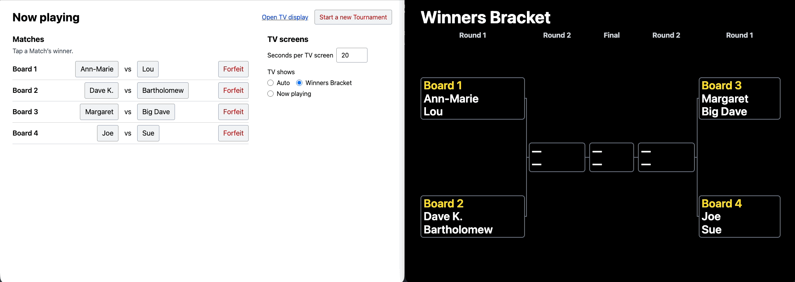
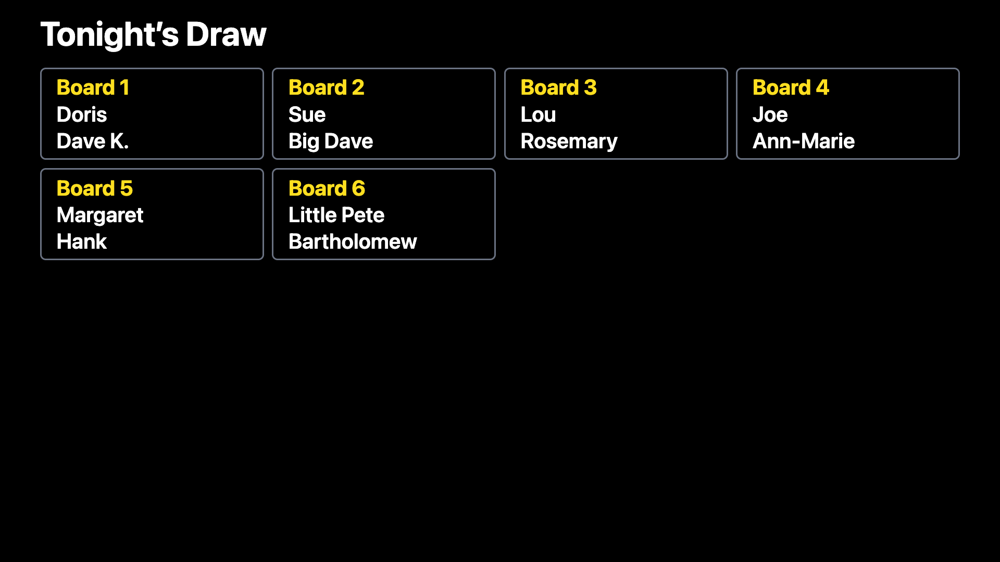
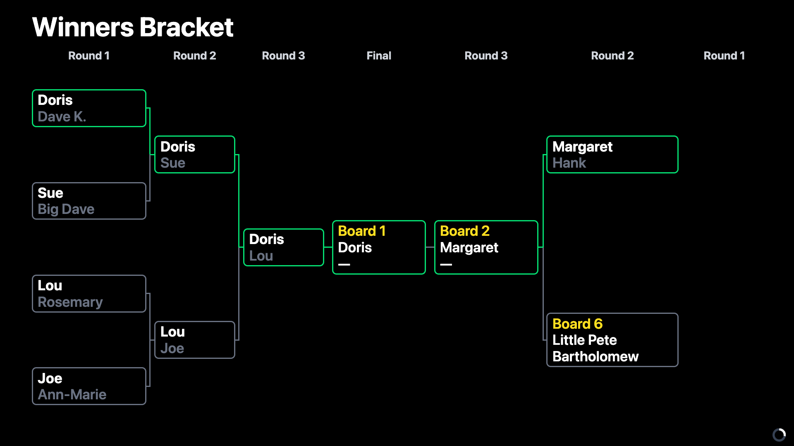
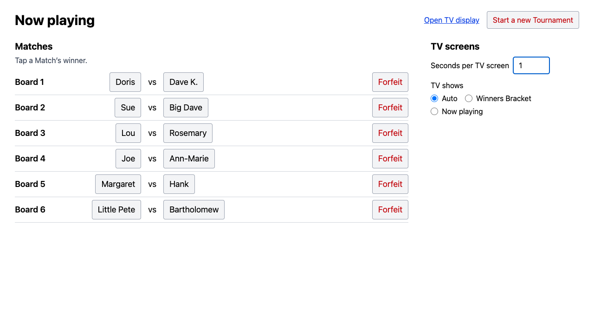

# Cribbage Tournament App

An app for running a monthly cribbage Tournament at a local brewery. The Organizer runs the bracket from a laptop connected to a TV, and the Players in the room can view the up-to-date brackets and Boards.

## Live Demo

[Try it with 16 test Players and 8 Boards.](https://auk14hp.github.io/cribbage-tournament/?players=16&boards=8)

Click _Open TV display_ to open the TV's window beside the Organizer's, as the laptop would on the night.

## Why An App?

The cribbage Tournament has traditionally been run by hand on paper.

When the Tournament begins, the Organizer calls out the initial Matches. Before he can finish, Players start trying to find their opponents, leading to chaos and confusion as the Organizer's announcements get drowned out with calls of "Are you Dave?"

As the Tournament progresses, Players report their results to the Organizer and only have insight into the Tournament's results by stealing a glance at the paper bracket.

The app solves these issues by displaying the Players, the current Matches, the Boards, and the bracket on the TV for all to see.

## What The App Does

- Displays Players as they sign up.
- Makes the Draw and displays the initial Matches and Board assignments.
- Gives Byes when the field doesn't fill the bracket.
- Records a Forfeit when a Player leaves before finishing their Match.
- Displays the current Matches.
- Displays the Winners Bracket.
- Draws and displays a Losers Bracket if enough Players opt into it after losing their first Match of the night.
- Cycles through different screens (Winners Bracket, Losers Bracket, Now playing, etc.) on the TV at a configurable interval. The Organizer can also hold the TV on one screen when desired.
- Allows one Player to be given a Home Board: a Board where they play all of their Matches, so they don't need to move around.
- Puts Matches in line, Waiting for a Board, when there are fewer Boards than Matches to play.

## Screenshots

## How I Built It

I wanted to practice AI-assisted coding, so I concentrated on using [Matt Pocock's skills](https://github.com/mattpocock/skills) for this project.

I started by using the skills to assist me in generating [a spec for the basic functionality of the app](https://github.com/Auk14HP/cribbage-tournament/issues/1).

In doing so I decided for the first iteration of the app I'd concentrate on having the app run on a laptop connected to the TV via an HDMI cable instead of something more complicated like a hosted site. The rationale for this decision was recorded in [an ADR](docs/adr/0001-laptop-only-for-v1.md).

I split that spec up into a set of initial issues and iterated through each of them. This consisted of:

1. Using Claude to implement the target issue using test-driven development.
2. Having Claude spawn sub-agents to do targeted code review, one checking the code against the coding standards and one against the issue's spec.
3. Opening a PR and doing a hands-on, human code review.
4. Updating ongoing documents like [CLAUDE.md](CLAUDE.md), [CODING_STANDARDS.md](CODING_STANDARDS.md), and [GLOSSARY.md](GLOSSARY.md) with findings and changes to keep from having to point out things in future issues.
5. Merging the PR and then running a retro on the target issue to identify areas for improvement in future AI-assisted coding sessions.

For example, the [Losers Bracket issue](https://github.com/Auk14HP/cribbage-tournament/issues/7) was built in [its PR](https://github.com/Auk14HP/cribbage-tournament/pull/45) and followed by [its retro](https://github.com/Auk14HP/cribbage-tournament/pull/48).

## Tech Stack

- Language: TypeScript
- Frontend: React ([why React](docs/adr/0002-react-for-the-routes.md))
- No server: the Organizer and TV screens are two windows on one laptop, sharing the Tournament through the browser's local storage ([why laptop-only](docs/adr/0001-laptop-only-for-v1.md))
- Build and dev server: Vite
- Styling: Tailwind CSS
- Testing: Vitest + Testing Library, and Playwright for the browser tests

## How To Run It Locally

You'll need Node 24 and, for the browser tests, Google Chrome.

1. `git clone https://github.com/Auk14HP/cribbage-tournament.git`
2. `cd cribbage-tournament`
3. `npm install`
4. `npm run dev`
5. Open the Organizer screen at the URL it prints.
6. Open the TV screen in a separate window with the "Open TV display" button.

To run the checks: `npm run check` (types, lint, formatting and unit tests) and `npm run e2e` (the browser tests).

## License

MIT. See [LICENSE](LICENSE).
